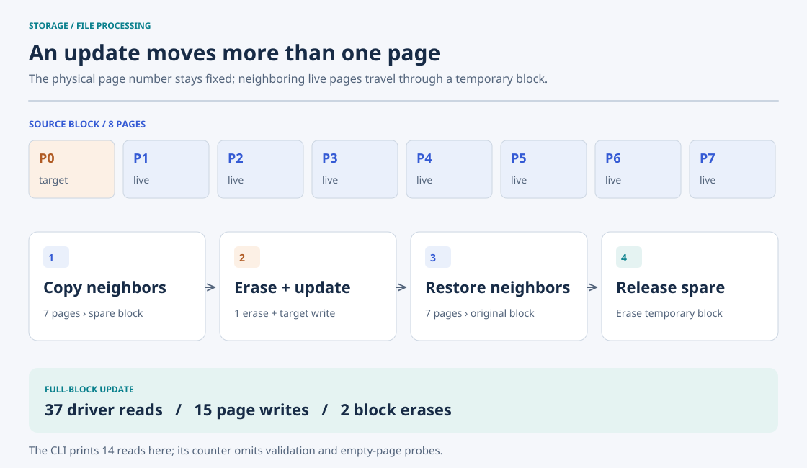

# Flash Device I/O

**Keep a page's physical address stable while updating its contents.** This C command-line manager operates a file-backed flash emulator through `fdd_read`, `fdd_write`, and `fdd_erase`. It handles empty-page writes directly and uses a temporary block to preserve neighboring pages during an update.



## Geometry and file format

| Unit | Size | Source |
| --- | --- | --- |
| Sector data | 512 bytes | `SECTOR_SIZE` |
| Spare area | 16 bytes | `SPARE_SIZE` |
| Page | 528 bytes | `PAGE_SIZE` |
| Block | 8 pages / 4,224 bytes | `PAGE_NUM`, `BLOCK_SIZE` |
| Image | User-selected block count × 4,224 bytes | `c` command |

`c` creates or truncates the image and calls `fdd_erase()` for each block, initializing every byte to `0xff`. A page's byte address is `528 * ppn`; a block begins at `4224 * pbn`. `ppn` and `pbn` are zero-based physical page and block numbers.

The CLI accepts text sector data and a decimal spare value. It writes a native four-byte integer at offset 512. It does not define a portable endian-independent format or initialize every unused sector/spare byte to a canonical value.

## Commands

From the repository root:

```bash
make -C 01-flash-io
./build/flash-io c /tmp/example.flash 2
./build/flash-io w /tmp/example.flash 0 hello 42
./build/flash-io w /tmp/example.flash 1 neighbor 7
./build/flash-io u /tmp/example.flash 0 updated 99
./build/flash-io r /tmp/example.flash 0 | tr -d '\000'
# updated 99
./build/flash-io e /tmp/example.flash 0
```

| Command | Arguments after the command | Behavior |
| --- | --- | --- |
| `c` | `IMAGE BLOCKS` | Create/truncate and erase all requested blocks |
| `w` | `IMAGE PPN TEXT SPARE` | Write only if the whole page is `0xff` |
| `r` | `IMAGE PPN` | Print sector bytes until the first `0xff`, then the spare integer |
| `e` | `IMAGE PBN` | Reset all eight pages in a block to `0xff` |
| `u` | `IMAGE PPN TEXT SPARE` | Update an occupied page through an empty temporary block |

Use an unused image path. `r` stops at `0xff`, not at a NUL terminator. The example removes NUL padding for readable terminal output; it is not a binary export interface. `u` fails if the target is empty or no completely empty block is available. An erased spare integer reads as `-1` on the measured native-int environment.

## Update algorithm

1. Validate the target page, ensure it is occupied, and check the text length.
2. `find_empty_block()` searches blocks from the end of the image, probing every candidate page.
3. Copy each occupied neighbor to the corresponding offset in that temporary block.
4. Erase the original block and write the replacement target at the original PPN.
5. Copy occupied neighbors back and erase the temporary block.

Empty neighbors are skipped. With `k` occupied pages including the target, successful updates issue `2k - 1` page writes and two block erases. The CLI's read counter is a manually maintained partial count; checks inside `is_page_empty()` and free-block search add real driver calls that it does not fully report.

## Measured behavior

Two-block images, target PPN 0, temporary block PBN 1:

| Occupied pages in source block | CLI reads | Actual driver reads | Page writes | Block erases |
| --- | ---: | ---: | ---: | ---: |
| 1 | 7 | 23 | 1 | 2 |
| 4 | 10 | 29 | 7 | 2 |
| 8 | 14 | 37 | 15 | 2 |

The fixture verified the updated sector prefix and spare value, compared all other source pages byte for byte, and confirmed that the temporary block returned to `0xff`. All images remained 8,448 bytes. Occupied-page writes and out-of-range reads/erases were rejected. [Method, raw results, and reproduction](../docs/measurements.md#flash-update).

## Source and limits

[src/ftlmgr.c](src/ftlmgr.c) owns command dispatch, range checks, empty-page probing, and the copy-out/copy-back algorithm. [src/fdevicedriver.c](src/fdevicedriver.c) supplies page read/write and block erase through `fseek`, `fread`, and `fwrite`; [src/flash.h](src/flash.h) defines geometry and its API. [Source guide](src/README.md).

The low-level driver can overwrite bytes directly; the manager implements only the selected flash-like restrictions. The update is not atomic and has no crash recovery or durability flush. Numeric parsing uses `atoi`, so validation is incomplete. A 512-character input passes the length check but `strcpy` needs a 513th byte for its terminator. Shared buffers are not reset on every operation, so bytes beyond the supplied text are not a stable serialized representation. These source-derived limits remain in the course implementation.
