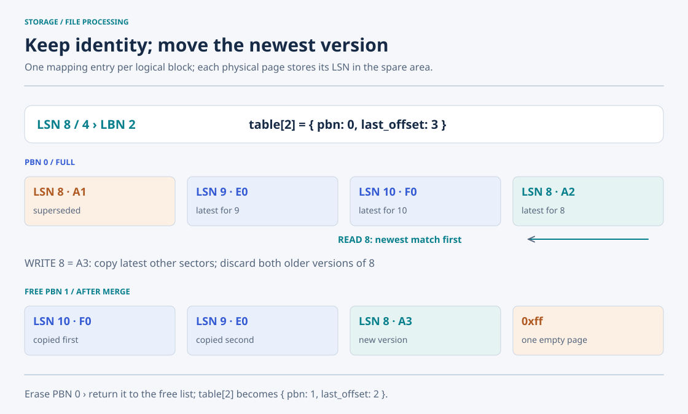
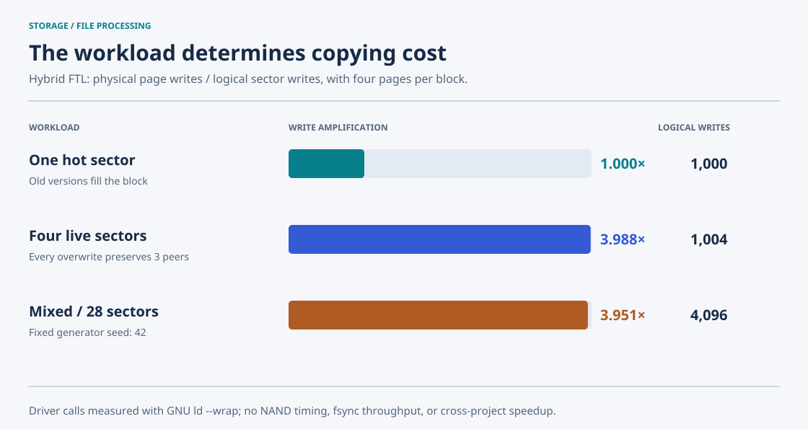

# Hybrid Flash Translation Layer

**Find the newest sector without keeping a page-level address table.** This FTL maps each logical block to a physical block, appends sector versions within that block, and searches their spare fields backward on reads. A full block triggers a latest-version merge into an available replacement.



## Addressing and state

| Configuration | Default value |
| --- | ---: |
| Sector / spare / page | 512 / 16 / 528 bytes |
| Pages per block | 4 |
| Physical blocks | 8 |
| Logical data blocks | 7 |
| Logical sectors | 28 (`0..27`) |
| Image size | 16,896 bytes |

`lbn = lsn / PAGES_PER_BLOCK`. Each mapping entry stores `pbn` and `last_offset`, initially `-1`. A linked list initially contains all physical blocks, in ascending allocation order. The logical capacity reserves one physical block so a merge can acquire a replacement even when all seven logical blocks have been allocated.

An appended physical page contains 512 caller-supplied bytes plus the LSN as a native integer at spare offset 0. Placement follows append order, so `lsn % PAGES_PER_BLOCK` identifies the logical sector within a block, not necessarily its physical page offset.

## Write, read, and merge

`ftl_write()` allocates a physical block on the first write to a logical block. If space remains, it writes at `last_offset + 1` and advances the offset. Old versions remain until the block is merged.

`ftl_read()` starts at `last_offset` and moves backward. Each probe reads one whole page, extracts its spare LSN, and stops at the first match. In the default geometry, a mapped-block lookup examines at most four pages. This trades a smaller block-level table for scanning during reads.

When `last_offset == PAGES_PER_BLOCK - 1`:

1. Acquire a free physical block and mark the requested sector as already handled.
2. Scan all pages of the old block backward.
3. Copy each other sector only on its first occurrence; this selects its latest version.
4. Erase the old block and return it to the free list.
5. Point the logical block at the replacement and append the requested sector.

With four distinct live sectors, each overwrite of a full block copies three peers and writes the update: four physical writes. With just one repeatedly updated sector, older versions are all discarded and a merge writes only the update. The implementation does not separate data and log blocks; "hybrid" here describes block mapping combined with append placement and spare-field scanning.

## API and demo

| Function | Caller contract / result |
| --- | --- |
| `ftl_open()` | Initialize the in-memory map and free list before operations on a fresh erased image |
| `ftl_write(int lsn, char *sectorbuf)` | Supply a valid LSN and a readable buffer of at least 512 bytes |
| `ftl_read(int lsn, char *sectorbuf)` | Supply a valid, previously written LSN and a writable 512-byte buffer |
| `ftl_print()` | Print `lbn pbn last_offset` and every logical-block mapping |

```bash
# From the repository root; isolate the generated image.
make -C 02-hybrid-ftl
repo_dir="$PWD"
demo_dir=$(mktemp -d)
(cd "$demo_dir" && "$repo_dir/build/hybrid-ftl")
```

The bundled demo writes `9=E0`, `8=A1`, `10=F0`, and `8=A2`, then checks that reading 8 returns A2. It prints:

```text
LSN 8: A2
lbn pbn last_offset
0 -1 -1
1 -1 -1
2 0 3
3 -1 -1
4 -1 -1
5 -1 -1
6 -1 -1
```

It creates or truncates `flashmemory` in its working directory. The original demo passed short string literals to an API that reads 512 bytes; it now uses zero-initialized full-sector buffers. The demo illustrates append and latest-version lookup; [experiments/hybrid_probe.c](../experiments/hybrid_probe.c) exercises repeated merges and binary read-back.

## Measured write cost



| Workload | Logical writes | Physical reads during writes | Physical writes | Erases | Write amplification |
| --- | ---: | ---: | ---: | ---: | ---: |
| One hot LSN | 1,000 | 996 | 1,000 | 249 | 1.000× |
| Four live LSNs in one block | 1,004 | 4,000 | 4,004 | 1,000 | 3.988× |
| Fixed mixed sequence over 28 LSNs | 4,096 | 16,156 | 16,184 | 4,039 | 3.951× |

Initialization and verification reads are excluded from these write costs. Every final sector matched its complete expected 512 bytes; the mixed workload also verified all then-written sectors every 64 writes. [Full method and results](../docs/measurements.md#hybrid-ftl).

## Source and limits

[src/ftlmgr.c](src/ftlmgr.c) implements the map, linked free list, append writes, backward reads, and merge. [src/fdevicedriver.c](src/fdevicedriver.c) implements physical file I/O, [src/hybridmapping.h](src/hybridmapping.h) defines geometry, and [src/main.c](src/main.c) supplies a fresh-image demonstration. [Source guide](src/README.md).

Mappings and the free list exist only in memory. `ftl_open()` does not reconstruct them from an existing image; reopening is unsupported. The API returns `void`, leaves a read buffer unchanged on a missing sector, and does not check LSN bounds, free-block exhaustion, or allocation failures. A partial merge failure has no rollback; the old block is erased before the requested replacement is written. The unused spare bytes are uninitialized. No wear leveling, bad-block management, concurrent access, crash recovery, or hardware timing is implemented.
