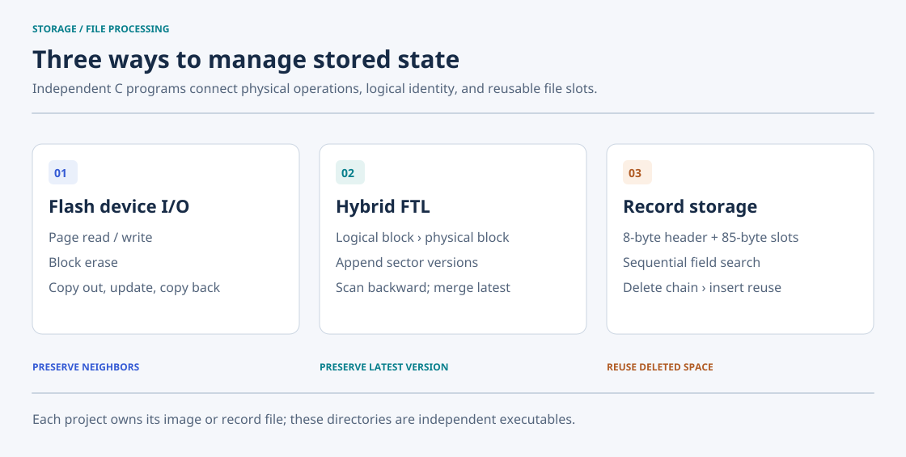
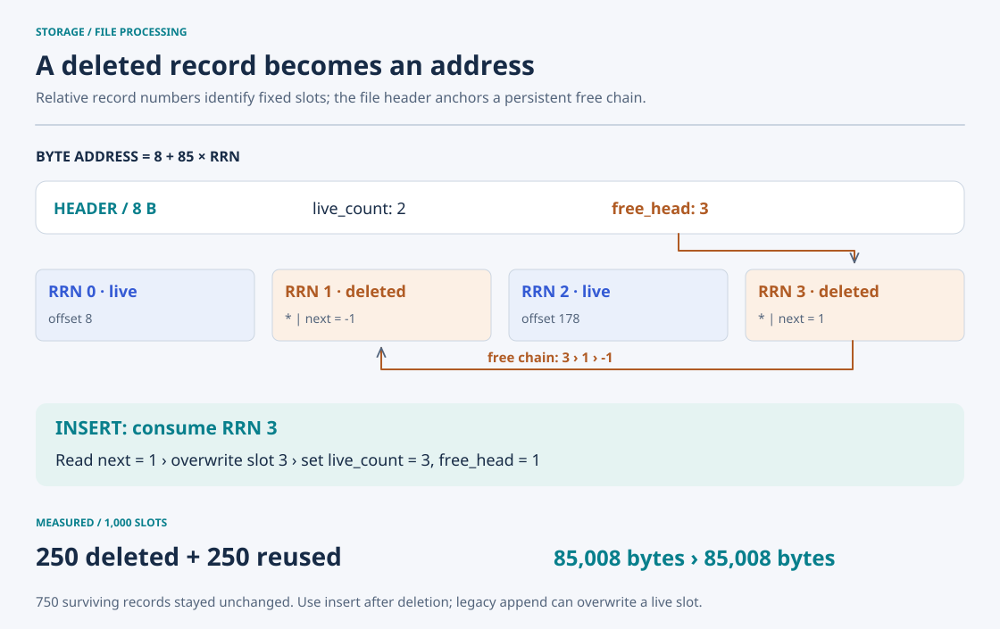

# Storage I/O Lab

**250 deleted record slots reused with zero file growth; 1.000× write amplification for repeated writes to one logical sector.** Three C projects implement file-backed flash I/O, a hybrid Flash Translation Layer (FTL), and fixed-slot record storage, with reproducible measurements and content verification.

| Measured result | Workload | Verification |
| --- | --- | --- |
| **85,008 bytes before and after reuse; zero growth** | Delete 250 of 1,000 records, then insert 250 replacements | All 250 slots reused; all 750 surviving slots unchanged |
| **1.000× / 3.988× / 3.951× write amplification** | One hot sector / four live sectors / deterministic mixed writes across 28 sectors | 6,100 logical writes; 1,820 complete 512-byte sector comparisons |
| **37 reads, 15 writes, 2 erases per full-block update** | Replace one page in a full eight-page block using an empty temporary block | All seven neighboring pages preserved; temporary block erased |

Write amplification is physical page writes divided by logical sector writes. These results measure emulator operations and file allocation. [Exact workloads and reproduction](docs/measurements.md) · [Saved results](experiments/results/latest.json).


## Implemented mechanisms

The flash manager keeps a physical page address stable by copying its neighbors through a temporary block. The FTL separates logical identity from physical placement: writes append versions, reads find the newest one, and a full block triggers a merge. The record manager uses a different form of indirection, linking deleted slots so an insert can consume existing space.



| Project | Implemented mechanism | Detailed README |
| --- | --- | --- |
| 01 · Flash I/O | Page read/write, block erase, and copy-out/copy-back update | [01-flash-io](01-flash-io/) |
| 02 · Hybrid FTL | Block mapping, append placement, backward lookup, and latest-version merge | [02-hybrid-ftl](02-hybrid-ftl/) |
| 03 · Record storage | Append, sequential field search, deletion chain, and slot reuse | [03-record-store](03-record-store/) |

## Flash I/O: preserve neighbors around an update

The emulator stores each page as **512 bytes of sector data + 16 bytes of spare data**. Reads and writes address a page; erases reset an entire eight-page block to `0xff`. The manager checks that a page is empty before writing it.

Updating an occupied page first copies the other live pages to an empty block. It then erases the original block, writes the new target, restores the neighbors, and erases the temporary block. The page address stays the same, but an update can move substantial data.


A controlled full-block update made **15 page writes and two block erases**, while preserving all seven neighbors byte for byte. Instrumentation counted **37 driver reads**; the CLI printed 14 because its local counter omits validation and several empty-page checks. These are emulator operation counts. The driver uses ordinary file I/O and does not enforce NAND programming physics. [Fixture and measurement method](docs/measurements.md#flash-update).

## Hybrid FTL: preserve logical identity across relocation

`ftl_write()` derives the logical block from the sector number, assigns a physical block, and appends a page containing the sector and its LSN. A mapping entry holds the physical block number and last occupied offset. `ftl_read()` scans backward through that block's spare fields, so a newer version wins over an older one.

When the block fills, the FTL scans it backward, copies the newest version of each other sector into a free block, and appends the requested update. It erases and returns the old block to the free list, then keeps using the replacement. This snapshot uses a block map with append placement inside each block; it does not maintain separate data and log blocks.


With four pages per block, measured write amplification ranged from **1.000× for repeated writes to one sector** to **3.988× while keeping all four sectors live**. A deterministic mixed workload across 28 logical sectors produced **3.951×**. All final sectors matched their expected 512-byte contents; the mixed run also checked readable contents every 64 writes. [Workloads, counts, and reproduction](docs/measurements.md#hybrid-ftl).

## Record storage: preserve reusable space after deletion

An eight-byte header stores the live-record count and free-list head. Each 85-byte slot stores five `#`-delimited fields. Deletion replaces a matching record with `*` and the previous free-head RRN, then makes that slot the new head. Insertion follows the link, overwrites the head slot, and advances the header without shifting surviving records.



In a **1,000-record fixture**, deleting 250 records and inserting 250 replacements reused all 250 slots. The file stayed at **85,008 bytes**, and all 750 surviving records stayed unchanged. The original append implementation confuses live count with physical slot count after deletion and can overwrite a live record; use `-i` after deletions. [Detailed format and reproduced limits](03-record-store/README.md).

## Build and try

Use Linux or WSL with GCC and Make. Python 3 and GNU ld are needed for the measurements.

```bash
make
./build/flash-io c /tmp/storage-demo.flash 2
./build/flash-io w /tmp/storage-demo.flash 0 hello 42
./build/flash-io u /tmp/storage-demo.flash 0 updated 43
./build/flash-io r /tmp/storage-demo.flash 0 | tr -d '\000'
# updated 43

# The hybrid demo creates "flashmemory" in its working directory.
repo_dir="$PWD"
demo_dir=$(mktemp -d)
(cd "$demo_dir" && "$repo_dir/build/hybrid-ftl")
# LSN 8: A2, followed by the mapping table

./build/record-store -a /tmp/storage-demo.dat 20260001 Ada CS Seoul ada@example.com
./build/record-store -s /tmp/storage-demo.dat 'SID=20260001'
make measure
```

The two `/tmp/storage-demo.*` paths are example files; choose unused paths when repeating the examples. `c` and the hybrid demo create or truncate their image. `make clean` removes only the three built executables. Each project can also be built with `make -C PROJECT`.

## Repository layout and validation

```text
01-flash-io/       # Physical page and block operations; src/ + detailed README
02-hybrid-ftl/     # Logical block mapping and merge; src/ + detailed README
03-record-store/   # Fixed-size records and deletion chain; src/ + detailed README
build/            # Generated executables, ignored by Git
docs/             # Measurement notes, validation, and SVG assets
experiments/      # Reproducible driver instrumentation and saved results
tools/            # SVG design source and regeneration instructions
```

The programs are independent course implementations. Each owns its image or record file, and generated executables live under `build/`. Detailed project READMEs explain formats, commands, and source paths.

[Validation notes](docs/validation.md) distinguish verified behavior from source-derived limits, including volatile FTL mappings, unchecked error paths, and record packing bounds. Measurements establish operation counts and slot reuse, not durable device throughput or production correctness. The five SVGs use outlined Noto Sans, accessible labels, and a shared restrained palette; [design and font license](docs/assets/README.md).
